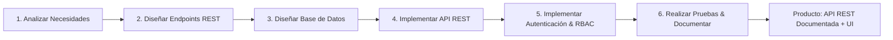
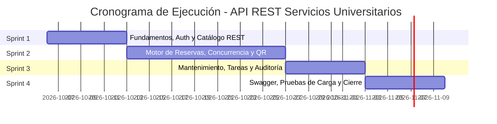

# Plan de Implementación Detallado — API REST para la Gestión de Servicios Universitarios

> **Materia:** Servicios Telemáticos (Carrera de Ingeniería Informática, UMSS)  
> **Unidad Curricular:** UNIDAD 1. Fundamentos y Arquitecturas Modernas  
> **Proyecto Oficial:** TRABAJO 1. API REST para la gestión de servicios universitarios  
> **Objetivo Académico:** Diseñar e implementar una API REST que permita gestionar información de un servicio universitario (laboratorios, horarios, reservas, check-in y auditoría).  
> **Criterios de Evaluación Docente:** Funcionalidad, Arquitectura, Seguridad, Rendimiento y Documentación.  
> **Tecnologías Obligatorias:** Node.js (TypeScript), REST (HTTP/JSON), PostgreSQL.  
> **Producto Esperado:** API funcional completamente documentada con OpenAPI/Swagger + Cliente Web de demostración en React.

---

## 1. Alineación Curricular con las 6 Actividades de la Unidad 1

El plan de trabajo se estructura formalmente sobre las **6 actividades pedagógicas y técnicas** establecidas para el Trabajo 1:



| Actividad Oficial | Enfoque en el Proyecto | Entregable Técnico Verificable |
| :--- | :--- | :--- |
| **1. Analizar necesidades del servicio** | Análisis del dominio de laboratorios de la UMSS, actores, flujos de colisión horaria y Product Backlog. | 27 Historias de Usuario con criterios de aceptación Gherkin y Matriz de Roles (RBAC). |
| **2. Diseñar endpoints** | Diseño de contratos RESTful: recursos URI, verbos HTTP (GET, POST, PUT, PATCH, DELETE), códigos de estado y esquemas JSON. | Especificación OpenAPI 3.0 / Swagger y diccionario de contratos. |
| **3. Diseñar base de datos** | Modelo relacional en PostgreSQL con integridad referencial, transacciones ACID y restricciones de exclusión para cero solapamientos. | Esquema Prisma, migraciones versionadas y scripts de seed. |
| **4. Implementar API** | Construcción del servidor Node.js + Express + TypeScript con arquitectura en capas (rutas, middlewares, controladores, servicios). | Código fuente modular, limpio, tipado y compilable al 100 %. |
| **5. Implementar autenticación** | Seguridad perimetral con tokens JWT, hashing seguro con bcrypt, control de acceso por roles y protección contra fuerza bruta. | Middlewares de autenticación y autorización probados (401/403/429). |
| **6. Realizar pruebas** | Pruebas funcionales de endpoints, pruebas de integración con Supertest y pruebas de carga/concurrencia sin fallos. | Suite de tests automatizados verde y reporte de pruebas de estrés. |

---

## 2. Decisiones Arquitectónicas (100 % RESTful Stateless)

En estricto cumplimiento con la **Unidad 1 (Arquitecturas Cliente-Servidor y APIs RESTful)**, el sistema descarta protocolos con estado como WebSockets, preservando la naturaleza **stateless** de HTTP:

### D1. Control de Concurrencia de Reservas (Garantía ACID en PostgreSQL)
- **Problema:** Múltiples solicitudes simultáneas para un mismo laboratorio en un mismo bloque de horario.
- **Solución Arquitectónica:** Restricción de exclusión en el motor PostgreSQL mediante `EXCLUDE USING gist`:
  ```sql
  CREATE EXTENSION IF NOT EXISTS btree_gist;
  ALTER TABLE reservas
    ADD CONSTRAINT reservas_sin_solapamiento
    EXCLUDE USING gist (
      laboratorio_id WITH =,
      tstzrange(fecha_inicio, fecha_fin, '[)') WITH &&
    ) WHERE (estado IN ('Pendiente', 'Aprobada'));
  ```
- **Respuesta REST:** Ante un conflicto de concurrencia, el servidor captura el error PostgreSQL `23P01` y responde con el código de estado semántico **HTTP 409 Conflict**.

### D2. Notificaciones y Estado del Servicio (REST Stateless)
- **Enfoque:** En lugar de WebSockets (que mantienen conexiones persistentes y estado en memoria), las notificaciones se gestionan como **recursos REST estándar**:
  - `GET /api/notificaciones`: Lista las notificaciones del usuario autenticado (paginadas, con filtro `leida=false`).
  - `PATCH /api/notificaciones/:id/leer`: Marca una notificación como leída.
  - `GET /api/notificaciones/resumen`: Devuelve el contador de notificaciones pendientes para la campana de la interfaz.
- **Cliente Web:** Utiliza `@tanstack/react-query` con intervalos de refresco controlados (`refetchInterval: 30000`), manteniendo el servidor desacoplado y sin estado.

### D3. Validación de Asistencia Presencial con Código QR
- Al aprobarse una reserva, el backend genera un token criptográfico único (`tokenQr`) codificado en base64url.
- El escaneo se procesa como una petición REST atómica:
  `POST /api/reservas/validar-qr` con payload `{ tokenQr: "..." }`.
- Validación de ventana temporal (±15 minutos desde el inicio). Si la reserva ya fue asistida o el token no es válido, se responde con HTTP 400 o 409 según corresponda.

### D4. Tareas Programadas en Segundo Plano
- Procesos automáticos de mantenimiento e inasistencia ejecutados mediante `node-cron` dentro del servidor, aplicando sentencias SQL `UPDATE ... WHERE` idempotentes.

---

## 3. Especificación de la API REST (Catálogo de Endpoints)

### 3.1. Módulo de Autenticación y Cuentas (`/api/auth`)
| Método | Endpoint | Rol Mínimo | Descripción | Códigos HTTP |
| :--- | :--- | :--- | :--- | :--- |
| `POST` | `/api/auth/register` | Público | Auto-registro de usuario con rol Estudiante por defecto. | 201, 400, 409 |
| `POST` | `/api/auth/login` | Público | Autenticación con correo y contraseña. Bloqueo tras 5 fallos. | 200, 400, 403, 429 |
| `POST` | `/api/auth/google` | Público | Autenticación federada mediante Google ID Token. | 200, 400, 403 |
| `POST` | `/api/auth/forgot-password` | Público | Solicitud de restablecimiento (anti-enumeración). | 200, 400 |
| `POST` | `/api/auth/reset-password` | Público | Actualización de contraseña mediante token de 1 solo uso. | 200, 400 |
| `PATCH` | `/api/auth/desactivar` | Autenticado | Auto-desactivación de cuenta de usuario. | 200, 401 |

### 3.2. Módulo de Gestión de Roles (`/api/roles`)
| Método | Endpoint | Rol Mínimo | Descripción | Códigos HTTP |
| :--- | :--- | :--- | :--- | :--- |
| `POST` | `/api/roles/solicitudes` | Estudiante | Solicitar ascenso a Docente o Auxiliar con justificativo. | 201, 400, 401 |
| `GET` | `/api/roles/solicitudes` | Administrador | Listar bandeja de solicitudes pendientes de rol. | 200, 401, 403 |
| `PATCH` | `/api/roles/solicitudes/:id` | Administrador | Aprobar o rechazar solicitud de ascenso. | 200, 400, 403, 404 |
| `DELETE` | `/api/roles/usuarios/:id` | Administrador | Revocar rol especial (protección de último admin). | 200, 403, 404, 422 |

### 3.3. Módulo de Laboratorios y Recursos (`/api/laboratorios`)
| Método | Endpoint | Rol Mínimo | Descripción | Códigos HTTP |
| :--- | :--- | :--- | :--- | :--- |
| `GET` | `/api/laboratorios` | Público | Catálogo con paginación (15/pág), orden y filtros. | 200, 400 |
| `GET` | `/api/laboratorios/:id` | Público | Detalle de laboratorio, equipamiento y carrera asociada. | 200, 404 |
| `GET` | `/api/laboratorios/:id/calendario` | Público | Disponibilidad horaria semanal y reservas ocupadas. | 200, 400, 404 |
| `POST` | `/api/laboratorios` | Administrador | Registro de nuevo laboratorio. | 201, 400, 401, 403, 409 |
| `PUT` | `/api/laboratorios/:id` | Administrador | Actualización completa de datos y capacidad. | 200, 400, 403, 404 |
| `DELETE` | `/api/laboratorios/:id` | Administrador | Deshabilitación / eliminación de laboratorio. | 200, 403, 404, 409 |

### 3.4. Módulo de Horarios y Equipamiento (`/api/laboratorios/:id/...`)
| Método | Endpoint | Rol Mínimo | Descripción | Códigos HTTP |
| :--- | :--- | :--- | :--- | :--- |
| `POST` | `/api/laboratorios/:id/horarios` | Administrador | Configuración de rangos horarios por día de la semana. | 201, 400, 403 |
| `POST` | `/api/equipamientos/laboratorio/:id` | Administrador | Vinculación de equipamiento y cantidad asignada. | 201, 400, 403 |
| `DELETE` | `/api/equipamientos/laboratorio/:id/:eqId` | Administrador | Desvinculación de equipamiento del laboratorio. | 200, 403, 404 |

### 3.5. Módulo Transaccional de Reservas (`/api/reservas`)
| Método | Endpoint | Rol Mínimo | Descripción | Códigos HTTP |
| :--- | :--- | :--- | :--- | :--- |
| `POST` | `/api/reservas` | Docente / Auxiliar | Solicitud de reserva (aula o individual). Concurrencia ACID. | 201, 400, 401, 403, 409 |
| `GET` | `/api/reservas/mis-reservas` | Autenticado | Listar historial de reservas del usuario en sesión. | 200, 401 |
| `GET` | `/api/reservas/pendientes` | Administrador | Bandeja de solicitudes de reserva para revisión. | 200, 401, 403 |
| `PATCH` | `/api/reservas/:id/aprobar` | Administrador | Aprobación de reserva y generación de `tokenQr`. | 200, 400, 403, 404 |
| `PATCH` | `/api/reservas/:id/rechazar` | Administrador | Rechazo con motivo obligatorio y liberación de horario. | 200, 400, 403, 404 |
| `PATCH` | `/api/reservas/:id/cancelar` | Solicitante / Admin| Cancelación anticipada (≥2 h antes) o fuerza mayor. | 200, 400, 403, 404 |
| `POST` | `/api/reservas/validar-qr` | Auxiliar / Admin | Validación presencial de asistencia por código QR. | 200, 400, 404, 409, 410 |

### 3.6. Módulo de Notificaciones y Auditoría (`/api/notificaciones` y `/api/auditoria`)
| Método | Endpoint | Rol Mínimo | Descripción | Códigos HTTP |
| :--- | :--- | :--- | :--- | :--- |
| `GET` | `/api/notificaciones` | Autenticado | Consulta de avisos y notificaciones del usuario. | 200, 401 |
| `PATCH` | `/api/notificaciones/:id/leer`| Autenticado | Marcar notificación como leída. | 200, 401, 404 |
| `GET` | `/api/auditoria` | Administrador | Registro de auditoría de transacciones y operaciones críticas. | 200, 401, 403 |
| `GET` | `/api/reportes/ocupacion` | Administrador | Exportación de reporte consolidado de uso (JSON/Excel). | 200, 401, 403 |

---

## 4. Plan de Sprints y Asignación del Equipo (6 Estudiantes)

Capacidad del equipo: 6 estudiantes de Ingeniería Informática.  
Organización ágil en 4 Sprints alineados a la entrega académica:



### Sprint 1: Cierre de Fundamentos, Autenticación y Catálogo REST (06/10 → 12/10)
- **Objetivo:** Tener la base arquitectónica completa, autenticación robusta y consulta pública del catálogo funcionando de punta a punta.
- **Asignación de Tareas:**
  - **José Luis Canaviri (Tech Lead / Backend):** Bloqueo por fuerza bruta (5 intentos/15 min) en login (HU-01); restablecimiento anti-enumeración de contraseña con token de 1 solo uso (HU-03).
  - **Herlan Ibañez (Backend):** Paginación a 15 elementos y orden alfabético en `/api/laboratorios` (HU-12, HU-14); endpoint de desvinculación de equipamiento (HU-08).
  - **Miguel Rodriguez (Backend / DevOps):** Migraciones de Prisma, docker-compose para PostgreSQL y validación de variables de entorno Zod (`env.ts`).
  - **Fernando Vera (Frontend Lead):** Catálogo de laboratorios con filtros en URL y visualizador semanal interactivo de horarios (HU-12, HU-13).
  - **Marco Antonio Callisaya (Frontend):** Vistas de Login, Registro, Solicitud de Roles y Recuperación de Contraseña integradas con la API.
  - **Andrés Montaño (QA / Testing):** Pruebas unitarias de controladores de autenticación y catálogo con Supertest; configuración de linter y scripts de prueba.

### Sprint 2: Motor Transaccional de Reservas, Concurrencia y Códigos QR (13/10 → 26/10)
- **Objetivo:** Desarrollar el núcleo transaccional del servicio universitario: solicitud, control de concurrencia ACID, aprobación, y validación por QR.
- **Asignación de Tareas:**
  - **José Luis Canaviri:** Lógica del servicio transaccional `reservas.service.ts` con manejo de conflictos `23P01` → HTTP 409 (HU-15).
  - **Miguel Rodriguez:** Migración SQL de restricción `EXCLUDE USING gist` en PostgreSQL y soporte para series recurrentes semestrales (HU-15).
  - **Herlan Ibañez:** Bandeja administrativa de aprobación/rechazo de reservas con motivo obligatorio (HU-16, HU-17) y endpoint de cancelación (HU-18).
  - **Andrés Montaño:** Módulo de generación de `tokenQr` criptográfico y endpoint atómico de validación presencial de asistencia (HU-22, HU-23).
  - **Fernando Vera:** Interfaz de solicitud de reserva, selección de horario y visualización de reservas propias en el cliente web.
  - **Marco Antonio Callisaya:** Módulo visual para escaneo y validación de QR para auxiliares y administradores.

### Sprint 3: Gestión de Mantenimiento, Tareas Automáticas y Auditoría (27/10 → 02/11)
- **Objetivo:** Automatización de reglas de negocio en segundo plano, reprogramación por mantenimiento y registro de trazabilidad.
- **Asignación de Tareas:**
  - **Herlan Ibañez:** Endpoints de mantenimiento preventivo y cancelación/reubicación en cascada de reservas afectadas (HU-09, HU-10).
  - **Miguel Rodriguez:** Tareas automáticas en segundo plano con `node-cron` para inasistencias (15 min) y rehabilitación de laboratorios (HU-11, HU-24).
  - **José Luis Canaviri:** Módulo de auditoría de transacciones (`/api/auditoria`) y endpoints de notificaciones REST (HU-20, HU-25).
  - **Fernando Vera & Marco Antonio Callisaya:** Panel administrativo de mantenimientos, bandeja de notificaciones y vista de auditoría.
  - **Andrés Montaño:** Pruebas de integración de tareas programadas y auditoría de cambios de estado.

### Sprint 4: Documentación Swagger/OpenAPI, Pruebas de Carga y Evaluación Final (03/11 → 09/11)
- **Objetivo:** Cumplir con los criterios finales de evaluación docente: Documentación Swagger completa, reporte de pruebas de estrés y demo integral.
- **Asignación de Tareas:**
  - **José Luis Canaviri & Miguel Rodriguez:** Integración de Swagger UI (`swagger-ui-express`) con la especificación completa de todos los endpoints, esquemas JSON y códigos HTTP.
  - **Andrés Montaño:** Ejecución de pruebas de concurrencia con k6 / Artillery: 50 peticiones concurrentes simultáneas sobre el mismo bloque horario (verificar 1×201 y 49×409 sin excepciones no controladas).
  - **Herlan Ibañez:** Generación de reportes de ocupación descargables en formato Excel/CSV (HU-27).
  - **Fernando Vera & Marco Antonio Callisaya:** Pulido de interfaz de usuario, optimizaciones de accesibilidad y pruebas E2E del flujo completo.
  - **Todo el equipo:** Ensayo de defensa y consolidación del informe técnico final.

---

## 5. Criterios de Evaluación y Matriz de Verificación Académica

| Criterio Docente | Qué se evalúa | Cómo se demuestra en la entrega |
| :--- | :--- | :--- |
| **1. Funcionalidad** | Cumplimiento del ciclo de vida del servicio universitario. | Las 27 HUs operativas; flujo completo desde búsqueda hasta validación de asistencia por QR. |
| **2. Arquitectura** | Separación Cliente-Servidor, diseño RESTful, modularidad y código limpio. | Modelo en capas estricto (Routes → Middlewares → Controllers → Services → Prisma); API completamente stateless. |
| **3. Seguridad** | Protección perimetral, integridad de credenciales y roles. | Tokens JWT firmados, passwords con bcrypt, RBAC en el 100 % de endpoints y rate limiting contra fuerza bruta. |
| **4. Rendimiento** | Concurrencia real sin colisiones y tiempos de respuesta. | Restricción PostgreSQL `EXCLUDE`; prueba de carga automatizada demostrando 0 duplicados y latencia < 300 ms. |
| **5. Documentación** | Documentación de la API y rigurosidad técnica. | Interfaz interactiva Swagger UI en `/api-docs` y manual del informe estructurado bajo la Taxonomía de Bloom. |
